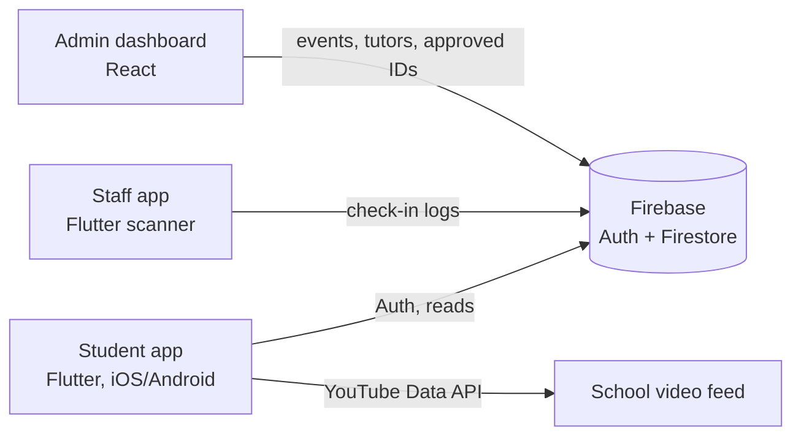

# Roosevelt Connect

A campus app for Eleanor Roosevelt High School (4,000+ students) that handles student check-ins, tutoring, events, and messaging. It's built with Flutter and Firebase and was shipped through 3 releases by a 6-student team led by Praneet Dumpa.

**Demo video:** [watch on Google Drive](https://drive.google.com/file/d/1CN5sS4f6tMbwBvweVUFLmkzMiYFsazmU/view?usp=sharing)

> This repository is a public **showcase**: an overview plus selected code excerpts. The production app handles student data, so its full source is private. Full code is available to recruiters on request.

## What it does

**For students**
- Digital student ID with a scannable barcode
- Tutor directory with 1:1 in-app chat
- Auto-updating daily agenda with the bell schedule
- School news and video feed (YouTube Data API)

**For staff**
- **ID-scan check-ins** using the phone camera or a USB handheld scanner, for attendance, off-campus lunch, forgot-ID, office hours, and events
- **Automatic tardy detection** from the bell schedule, including late-start Wednesdays and separate lunch periods
- **Event approval lists:** a scan is approved or denied against the list of students cleared for that event
- **Escalating consequences** for repeat forgot-ID and office-hours scans (warning, lunch detention, Wednesday detention, Saturday school, admin conference)
- Searchable check-in logs with CSV export, plus a detention log

**Admin web dashboard** (React): manage events and tutors, bulk-upload approved student IDs, and view check-in usage per teacher.

## Architecture

**Firestore collections**

| Collection | Purpose |
|---|---|
| `student_check-in_datalogs` | One document per scan: student ID, purpose, timestamp, tardy flag, approval, scanning teacher |
| `event_participants/approved_ids` | Student IDs cleared for the current event |
| `users` | Student profiles (looked up by school email) |
| `chat_rooms/{uidA_uidB}/messages` | 1:1 tutor chats; the room ID is the two sorted UIDs, so either side finds the same room |

## Code excerpts

| File | What it shows |
|---|---|
| [`excerpts/checkin/found_barcode.dart`](excerpts/checkin/found_barcode.dart) | The scan handler: routes each scan by purpose, checks event approval lists, applies the lunch-period tardy rules, escalates consequences, and records the session table |
| [`excerpts/checkin/check_in_and_tardy.dart`](excerpts/checkin/check_in_and_tardy.dart) | Parses the student ID from a school email, computes tardiness from the bell schedule, writes the log, and returns the student profile |
| [`excerpts/checkin/scan_count.dart`](excerpts/checkin/scan_count.dart) | Counts prior scans per student and purpose for the consequence ladder |
| [`excerpts/chat/chat_service.dart`](excerpts/chat/chat_service.dart) | Deterministic chat-room IDs, merge-writes for room metadata, and real-time message streams |
| [`excerpts/youtube/api_service.dart`](excerpts/youtube/api_service.dart) | YouTube channel and playlist fetching with pagination; the key is injected at build time |

## Tech
Flutter · Dart · Firebase Auth · Cloud Firestore · mobile_scanner · React (admin dashboard) · YouTube Data API

## Team
Built by a 6-student team at Eleanor Roosevelt High School:

- **Praneet Dumpa** (team lead)
- Devom Brahmbhatt
- Satya Lakkaraju
- Jacob Wu
- Preston Lee
- Nataniel Jayaseelan
